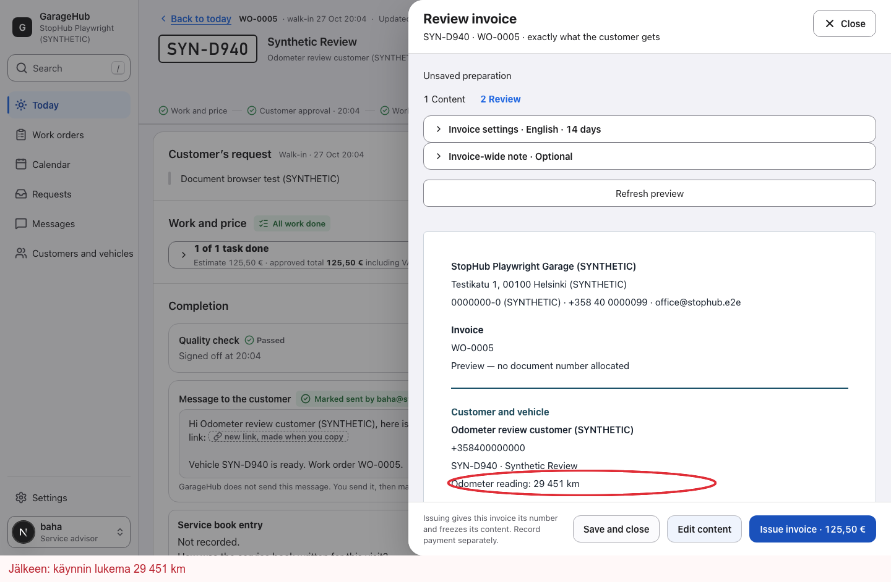

# Checking the odometer before issuing an invoice

A product case study by **Jose Lehtimäki**, from my AI-assisted repair-shop software project.

Office staff could review an invoice without seeing the odometer reading that would appear on the issued PDF. The change makes this visit's reading visible before the invoice is issued, so the person checking it can spot an incorrect entry at the right point in the workflow.

## Before and after

| Before | After |
| --- | --- |
| The review showed the customer and vehicle, but omitted the visit's odometer reading. | The review also shows **Odometer reading: 29 451 km**, matching the value in the issued invoice. |
| A typo in that value was not visible in this review step. | Staff can check the value before choosing **Issue invoice**. |

[View the matching before screenshot](assets/invoice-review-before.png). Both images come from recorded local browser tests on 27 October 2026 and use synthetic data.

## My role

The gap was first identified during an earlier AI-assisted review. I turned it into a bounded workday requirement: the office must be able to check the same visit reading that the invoice will record, before issuing it.

I set the user outcome, approved the scope and authorised delivery of this change. AI coding agents implemented the change and tests; a separate AI review session examined the implementation. This is an example of my product direction and use of AI-assisted development.

## Decisions that mattered

- Use the reading recorded for **this visit**. Do not silently replace a missing value with an older reading from the vehicle's history.
- Show a genuine **0 km** reading. If the reading is absent, omit the row rather than inventing a value or displaying a dash.
- Use the invoice's Finnish or English language, even when the staff interface uses a different language.
- Keep the review consistent with the issued PDF.
- Reuse the existing prepared invoice data. This change did not need a new database field, API or invoice calculation.

## What was delivered and checked

The change was merged on **27 October 2026**. The display logic and its component tests were confirmed in the main branch on **2 November 2026**.

The delivery record includes focused component, API and browser tests, a separate AI-assisted review, and a successful GitHub Actions run. Checks covered Finnish and English, zero and missing readings, compatibility with the work-report view, desktop and narrow mobile layouts, and comparison with the generated invoice PDF.

[Read the verification notes](EVIDENCE.md) for the versions, recorded results and limits.

The demonstrated result is that the reading is available at the invoice review step. Time saved and the effect on invoice corrections have **not yet been measured**. The records summarised here do not establish that this change has been verified in live workshop use.

---

[About me](https://github.com/joselehti-sudo) · [LinkedIn](https://www.linkedin.com/in/jose-lehtim%C3%A4ki-a22a36171/)

This repository is a public case study. The application source and delivery records remain in a private repository.
