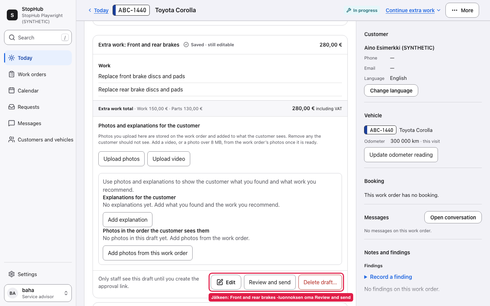

# Customer workflows, product decisions and AI-assisted delivery

**Jose Lehtimäki** · Customer work, practical software and AI-assisted projects

I work with customers and build software with AI agents. These case studies show how a practical problem becomes a product decision, an implementation and something we can check.

My contribution is understanding the work, setting the goal, deciding scope and reviewing the user outcome. AI coding agents do much of the implementation and technical testing. Each case makes that division clear.

## Start with the extra-work case

### [Sending the right extra work without losing its history](cases/extra-work-approval.md)

An empty older draft blocked the office from sending a newer brake-work proposal. The change gives each draft its own review path and allows unused drafts to be removed within explicit limits.

**Read for:** problem framing, recovery from mistakes, approval boundaries and a review that caught a remaining defect.

*Recorded application screenshot with synthetic data, 24 October 2026. The full case includes the matching before image.*

### [Keeping a human in control of an AI-written offer](cases/human-reviewed-offers.md)

An English-speaking operator needs to check the whole offer before a Finnish customer version is prepared. Corrections, approval, translation and sending have different meanings.

**Read for:** workflow design, bounded AI changes, source quality and honest validation. This is a local trial. A fresh, limited offline check passed **45/45 tests**; it does not establish real operator acceptance or translation accuracy.

### [Checking the odometer before issuing an invoice](cases/invoice-review.md)

A smaller example: expose the current visit's reading at the point where office staff review the invoice.

**Read for:** a narrowly scoped improvement and consistency between review and the issued document.

## Questions I am working through

These two notes show work that is still developing. Each follows one question through the available evidence and explains the next check.

### [Vire: when the training plan does not fit everyday life](cases/vire-program-fit.md)

A coaching app can notice repeated time pressure. But what should that signal mean when the app itself shortened the session? The note explains the distinction the coach needs to make, my product role and the decision still open.

### [AI work: keeping recommendations separate from decisions](cases/ai-recommendation-boundaries.md)

A small recorded evaluation raised a question about how a suggested sequence can read like an agreed plan. I explain the observation, the wording change and why a comparison is still needed before calling it an improvement.

## Evidence and next steps

- [Evidence index](EVIDENCE.md): what was inspected now, what comes from delivery records, and what remains unproven.
- [Validation plan](VALIDATION-PLAN.md): the next usability and business checks, with tasks, measurements and stopping conditions.

The workshop changes are merged. Their live usability and business impact are not established by these cases. The offer workflow remains a local trial. No time savings, revenue gains or production-readiness claim is inferred from passing tests.

Source applications remain private. Public screenshots use synthetic fixtures; the portfolio contains curated summaries and a limited test report.

[GitHub profile](https://github.com/joselehti-sudo) · [LinkedIn](https://www.linkedin.com/in/jose-lehtim%C3%A4ki-a22a36171/)

_Last evidence review: 2 November 2026._
