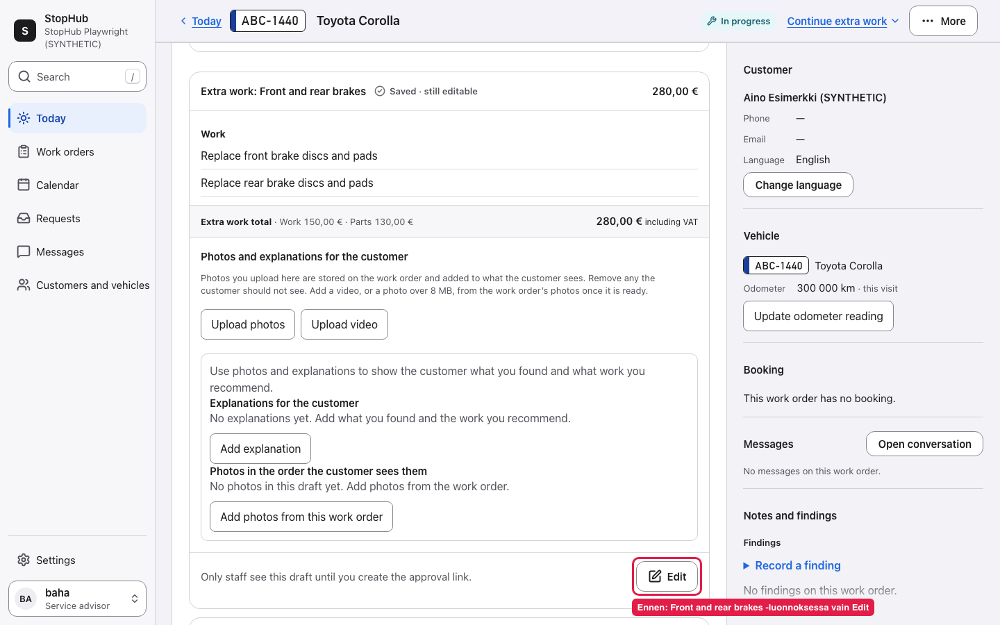
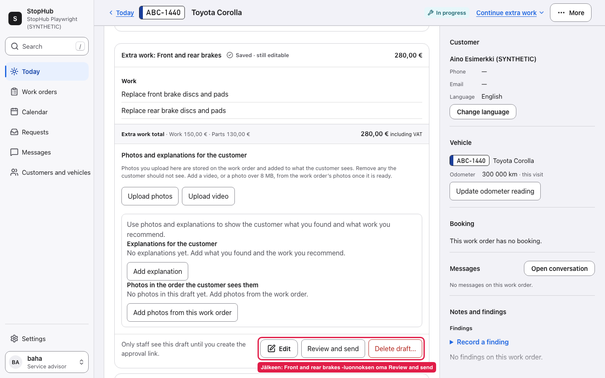
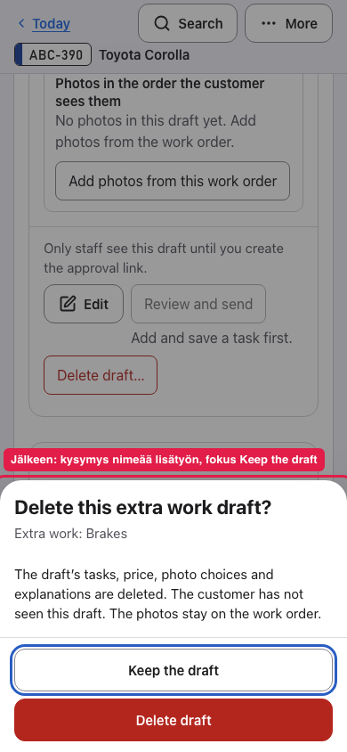

# Sending the right extra work without losing its history

[Portfolio](../README.md) · [Evidence](../evidence/extra-work.md)

**Project:** repair-shop software  
**My role:** product direction and scope approval; AI-assisted implementation and technical review  
**Delivery:** merged 25 October 2026; this case covers issue #645 A–B  
**Outcome demonstrated:** a newer draft has its own review path; an eligible unused draft can be removed. Live business impact has not been measured.

## The situation

The original repair had already been approved. The office then had two extra-work drafts: an older empty one and a newer one containing front and rear brake work.

The header's next-step action kept pointing to the older unfinished draft. The newer draft had no review-and-send action of its own. The empty draft could not be removed: **Discard** only discarded edits.

This was recorded as an office usability problem and reproduced in a synthetic acceptance scenario. The consequence was concrete: the office could not reach the customer-approval step for the work it actually wanted to propose.

It matters because an approval needs to belong to a particular scope and price. The original repair's approval must not silently authorise later work.

## My contribution

On 24 October I explicitly approved this workday goal: the office can send the newer front-and-rear-brake proposal and remove the unnecessary unpublished draft.

That owner decision is recorded in the issue and pull request. I authorised delivery subject to the project's review and CI requirements. AI agents investigated the implementation, wrote code and tests, and ran separate review sessions. The technical stale-data defect described below was found by an AI reviewer, not by me.

## What changed

| Before | Delivered behaviour |
|---|---|
| The header was the only route and selected the oldest unfinished draft. | Each draft has its own **Review and send**, tied to that draft's version. |
| The office could discard edits but could not remove the empty draft. | **Delete draft…** names the draft and asks for confirmation. |
| A global next step obscured the specific item the user wanted to act on. | The header remains a recommendation; the draft also offers its own permitted actions. |

*Matching 1440 px captures from the recorded local test. Red annotations are part of the original evidence.*

In the synthetic scenario, the original approved work is **€520**. The newer proposal is **€280**: €150 of work and €130 of parts. Its review shows those two new tasks and that €280 amount, without inheriting the original approval. These are test amounts, not revenue or pricing recommendations.

## Decisions and tradeoffs

The first two decisions follow the approved user goal. The implementation and review records derive the technical safeguards; they are not all personal design claims.

| Decision | Reason | Cost or limit |
|---|---|---|
| Add an action to each draft using the existing review sheet. | The office chooses the actual proposal. | There are both header and local actions, whose purpose must remain clear. |
| Keep **Discard edits** separate from **Delete draft**. | Reverting an edit and removing a proposal are different intentions. | Deletion needs a separate, explicit confirmation. |
| Delete only eligible drafts that have never been published and have no earlier version or approval history. | Removing a mistaken draft must not erase what the customer was offered. | Some drafts remain undeletable even when staff would prefer to tidy them away. |
| Keep drafts linked to workshop findings outside this deletion scope. | Deleting one could leave the original finding incorrectly treated as handled. | This recovery path needs a separate product decision. |
| Refuse deletion if the draft changed after the confirmation opened. | The user must not delete someone else's unseen edits. | A stale view requires another read and decision. |

*The confirmation names the target and keeps the non-destructive choice focused.*

The implementation uses the same deletion rule for the action shown to staff and for the server command. A disabled control alone would not protect the data.

## The review changed the result

An intermediate implementation still had a serious gap. If another writer changed a line's quantity, unit or pricing type while the deletion question was open, the old deletion request could still succeed.

A separate AI review reproduced that behaviour and blocked delivery. The fix included those fields in the version check. The delivery record then shows:

1. A browser test reproducing the failure on the earlier code.
2. API tests for the three affected fields.
3. A corrected stale request returning a conflict while preserving the draft.
4. A fresh read allowing the user to make the decision again.
5. A later review accepting the corrected version.

This is the part of the case I would discuss in an interview: the visible interaction improved, but the implementation still needed to protect the intent behind the confirmation.

## What the evidence supports

The change was merged on 25 October. On 2 November the current source still contained the deletion limits and expanded version check. GitHub's latest attempt of the recorded CI run showed all 18 jobs successful on the delivered commit.

Historical browser records cover desktop and mobile, keyboard focus, preserving the original approval, reload persistence and publication/deletion races. Those tests were not rerun for this portfolio.

The evidence does **not** establish faster real office work, fewer support calls or increased sales. A separate media-loading feedback issue was left as a follow-up at delivery. Replacement versions and the whole additional-work programme are not completed by this one change.

## What I would validate next

Ask an office user to recover from the two-draft situation without coaching. Observe whether they pick the correct proposal, understand the €280 scope, remove only the empty draft and distinguish a created link from a customer's approval.

Then test a second session changing the draft during confirmation. The important outcome is that the user understands why deletion stopped and can recover. [The full validation plan](../VALIDATION-PLAN.md) defines the tasks and measurements.
