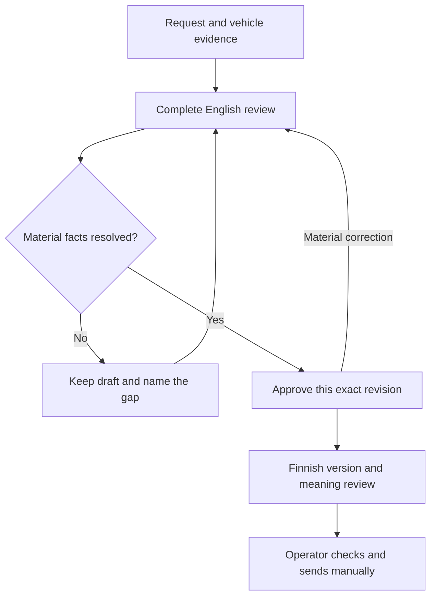

# Keeping a human in control of an AI-written offer

[Portfolio](../README.md) · [Evidence and fresh test report](../evidence/offer-workflow.md)

**Project:** local offer workspace for a repair-shop operator  
**My role:** commissioning and directing the workflow; defining operator-facing requirements and source boundaries  
**Implementation:** AI-assisted development using a shared local helper  
**Status:** local trial; real operator acceptance and live platform behaviour are not established

## The problem

The operator works in English, while the customer offer is normally Finnish. An AI assistant can produce a fluent offer while changing a price, dropping an exclusion or treating a request to translate as approval.

A short English summary would not be enough: the operator needs to review the actual promise being made to the customer. The workflow therefore presents the complete English offer, with internal reasoning kept separately, before preparing a Finnish version.

The goal is useful assistance with a visible decision point: the operator checks the work and price that the customer will receive.

## My role and the evidence behind it

The project records attribute the workflow commission and subsequent requirements to me. These include source routing, keeping the main price visible, limiting external source reads and keeping the process usable through ordinary conversation.

AI agents implemented the helper, revision storage, validations and tests. I am not presenting their code as independently written by me, or the synthetic test operator as the real workshop owner.

The known-limitations document also records an earlier AI interpretation of an ambiguous component description as if it were a confirmed repair rule. The ambiguity was retained as unresolved. That is a useful failure to expose: a confident explanation must not become the authority for a repair promise.

## The workflow

A correction creates a new revision. Approval of the old revision does not transfer to the changed offer.

## Decisions that matter

| Decision | User or business reason | Limitation |
|---|---|---|
| Show the complete English offer and its main price. | The operator can review all work, extras and terms. | The review still takes attention; it is not automatic approval. |
| Apply a correction only to the identified fields and show the differences. | Checking two facts should not silently reprice the whole job. | A necessary dependent change must be explained. |
| Tie approval to the current case and exact revision. | “Looks good” must refer to something specific. | A later material edit needs a new decision. |
| Separate owner-confirmed facts from independently sourced facts. | A person saying they checked something is useful evidence with known attribution. | It is not the same as reading an authoritative source for that exact vehicle. |
| Keep structural checks separate from meaning review. | Identical numbers do not guarantee an equivalent promise. | Mechanical tests cannot establish translation accuracy. |
| Keep sending manual; block the prototype's submit entry points. | Preparing a customer text and committing it externally are different actions. | This helper does not control every other tool the operator may have. |

The current design uses one helper and saved case revisions for Claude and Codex. The saved case is the handover. A model's recollection of an earlier conversation is not the case record.

## A concrete correction

Consider a synthetic offer with an agreed main price. The operator confirms two technical facts and asks to update only those facts.

The expected result is a new complete review with those fields changed, while price, extras, hours and unrelated wording remain unchanged. If the price also needs to change, that is disclosed as a separate decision. Trying to finalise the changed review using its previous approval must fail.

This scenario is represented in the current tests. It is not a claim that a model will interpret every natural-language instruction correctly.

## What was checked now

On **2 November 2026**, an AI assistant preparing this portfolio ran two existing test files offline against a pinned source snapshot:

- **42 review tests:** scoped corrections, stale approval, missing or conflicting evidence, prices, structural translation checks and separation of offer approval from reusable rules.
- **3 submit-block tests:** direct submit and the actual CLI source, including `--confirm`, reject without touching the browser adapter.

**45 passed, 0 failed, 0 skipped.** The six input files were checked against their Git blob identities. [The raw test output and manifest are published](../evidence/offer-workflow.md).

One particularly useful test deliberately reverses the meaning of a sentence while keeping its numbers. The renderer does not claim semantic equivalence: it returns a state requiring meaning review. That exposes the boundary of the mechanical checks.

## What remains unproven

The fresh run did not exercise a language model, a Desktop app, a licensed vehicle-data portal or live AutoJerry. It did not test the whole repository, estimate pricing accuracy or measure translation quality.

The older delivery notes report synthetic Claude/Codex handovers, but their original run transcripts were not rechecked here. They are historical records, not fresh validation.

The next step is an operator-reviewed trial using an agreed evaluation set: compare the complete review with the intended Finnish promise, record corrections and unresolved facts, and measure review effort. A sendable-looking text with an incorrect scope is a failure even when every software check passes. [See the proposed validation plan](../VALIDATION-PLAN.md).
